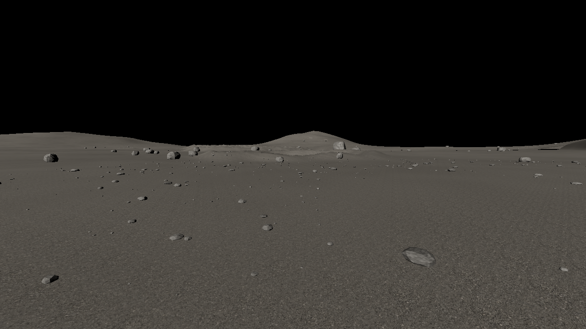
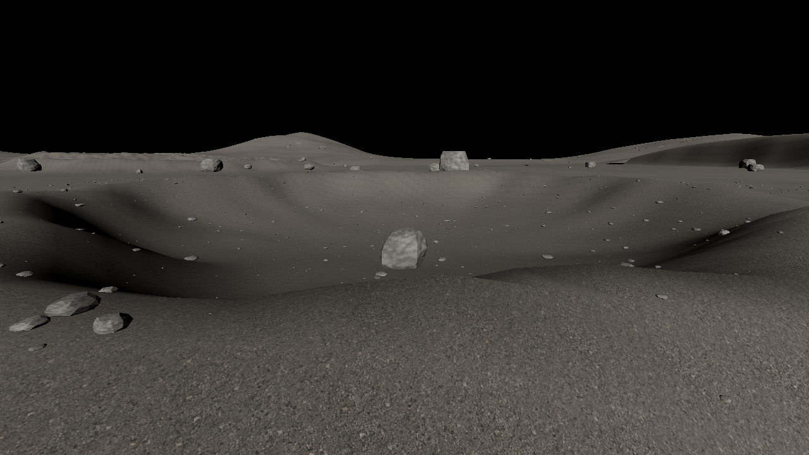

# Moon surface refinement · 1.2.2

The eight supplied references were visually inspected. They guide the surface
art while the existing NASA elevation arrays, 1.62 m/s² lunar gravity, shared
astronomical positions and Mare Tranquillitatis setting remain intact.

| Reference cue | Implementation |
| --- | --- |
| Fine grey powder and tiny angular fragments | Authored regolith tile at 0.8 m scale; two rotated world-space samples blend with broader nonrepeating mineral variation. |
| Sparse larger stones among much finer grains | Deterministic mixed-size instanced gravel follows EVA movement. Additional solid boulders cluster near crater rims; equipment approaches stay clear. |
| Fractured boulders | Individually seeded cutting planes and finer large-rock geometry, with rough basalt material. |
| Irregular crater rims and loose wall debris | Variable rim width, subdued wall detail and geometric impact bowls on the same pickable walking surface. |
| Deep, crisp shadows against a black sky | Sun-facing open terrain casts shadows; coverage moves ahead of the first-person camera without changing the dated Sun direction. No lunar atmospheric haze. |
| Dust impressions and an astronaut-scale viewpoint | Existing boot treads, rover tracks, 1.7 m eye height, 360° look and actual triangle-based footing are retained. |

The futuristic habitats and scarp pictures are conceptual references, not surveys
of this landing site. Added craters, ridges, boulders and microdetail remain
explicitly authored. Earth size and location are not enlarged to imitate an
illustration. The game uses a small navigation fill light and suit lamp; this is
a readability aid rather than a physically exact multi-bounce lighting solver.

## Authored material

`dist/assets/lunar-regolith.png` was generated with the built-in image-generation
tool as a new neutral-grey, top-down material tile. It is not NASA imagery.
The unmodified decoded colour bytes also supply an approximate micro-height
signal (3 mm full range); they do not measure particle height. Geometry supplies
large terrain and rock shadows. A deterministic procedural material remains
available while decoding or if decoding fails.

Generation prompt:

> Create a new game texture asset: one square, seamless tileable photorealistic
> PBR albedo image of lunar regolith, viewed perfectly orthographically from
> directly overhead. This is a flat material colour texture, not a landscape
> scene. Fill the frame with neutral charcoal and ash-grey compacted lunar
> powder, varied fine irregular angular mineral grains, tiny basalt fragments
> and sparse millimetre-scale micro-pits. Intended physical coverage: 0.8 metre
> square. Most particles are very small, with occasional centimetre fragments;
> no large rocks. Flat diffuse illumination, no directional shadows, highlights,
> baked lighting, dark occlusion outlines or vignette. Match opposite edges
> seamlessly and avoid distinctive repetition. No sky, horizon, astronaut,
> buildings, footprints, rover marks, vegetation, dunes, orange tint, text or
> watermark. Texture asset only.

`tools/embed-lunar-texture.mjs` embeds the PNG into a JavaScript module during
the client build. The offline HTML carries the same pixels. Replace the source
PNG and run `npm run build` to update it.

## Changed code

| File | Purpose |
| --- | --- |
| `dist/lunar-surface.js` | Embedded texture decode, matching metre-based albedo/bump samples, physical bump gradients, fractured rocks and mixed-size gravel. |
| `dist/surface-materials.js` | Shared lunar maps so a decoded tile updates all patches together. |
| `dist/reference-landscape.js` | Crater wall detail and extra rim boulders with collision envelopes. |
| `dist/render-3d.js` | Terrain shadow casting, view-following coverage and cancelled texture updates after disposal. |
| `tools/embed-lunar-texture.mjs` | Reproducible offline asset packaging. |
| `tests/lunar-surface.test.mjs` | EVA gravel continuity, pickable footing, lighting, late texture decode and 360° shadow coverage. |

## Terrain render checks

These images render the actual terrain meshes, material shaders, texture,
camera and Sun using Mesa software OpenGL ES. They omit the astronaut, outpost,
spacecraft, sky bodies and interface. They are terrain checks, not full browser
screenshots or performance benchmarks.

## Try the update

Extract the ZIP, open `LUNA` in VS Code, then run `npm start` with Node.js 22 or
newer and open `http://localhost:3000`. Choose Moon. On the surface, press **F**
for astronaut view and drag to look. **Settings → Graphics quality** changes
gravel density. Use `npm ci` and `npm run dev` when editing source.
